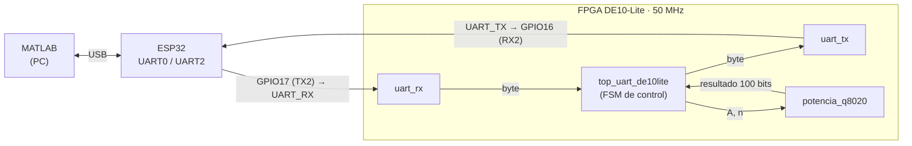
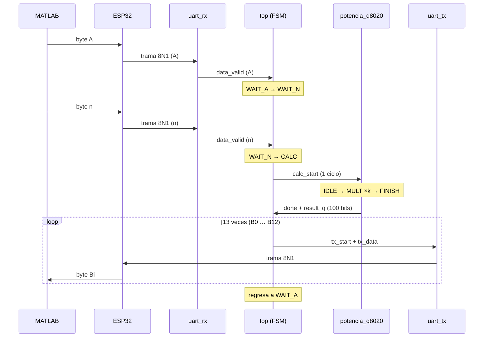
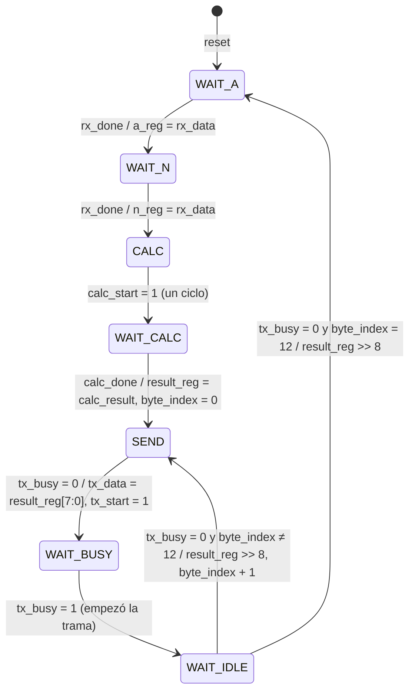
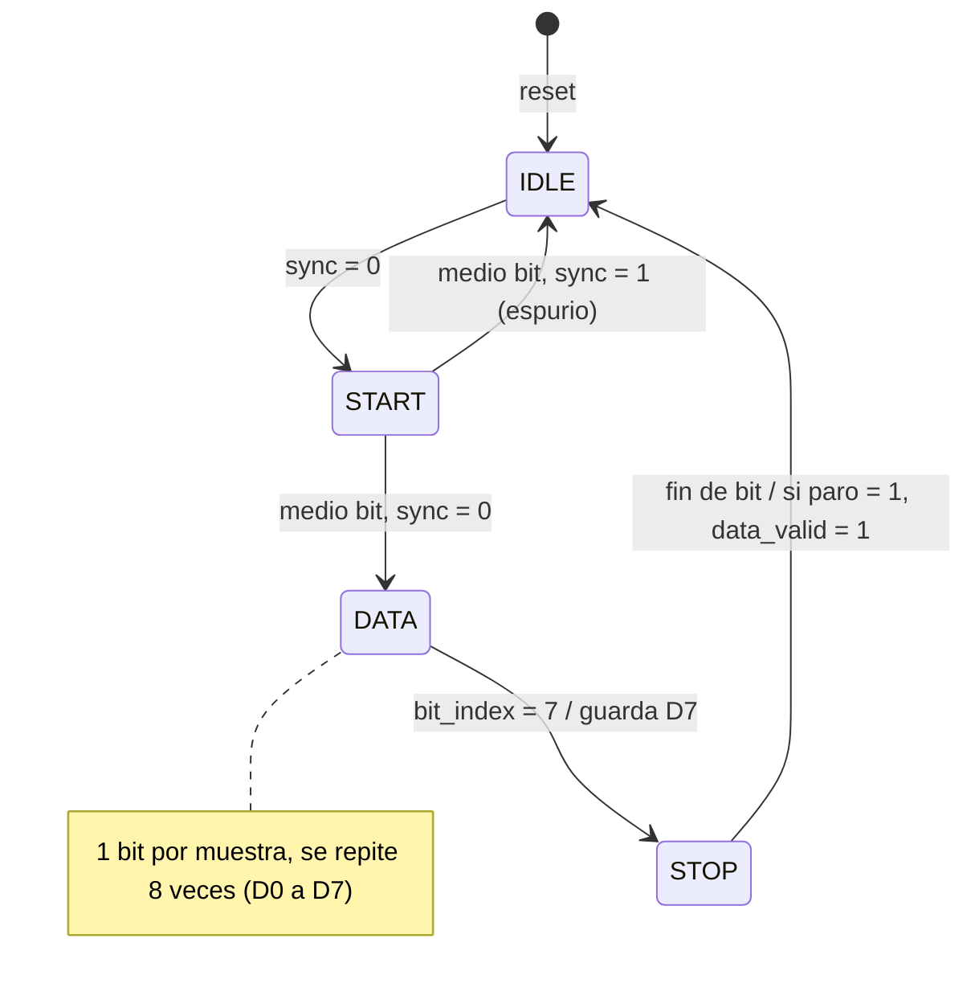
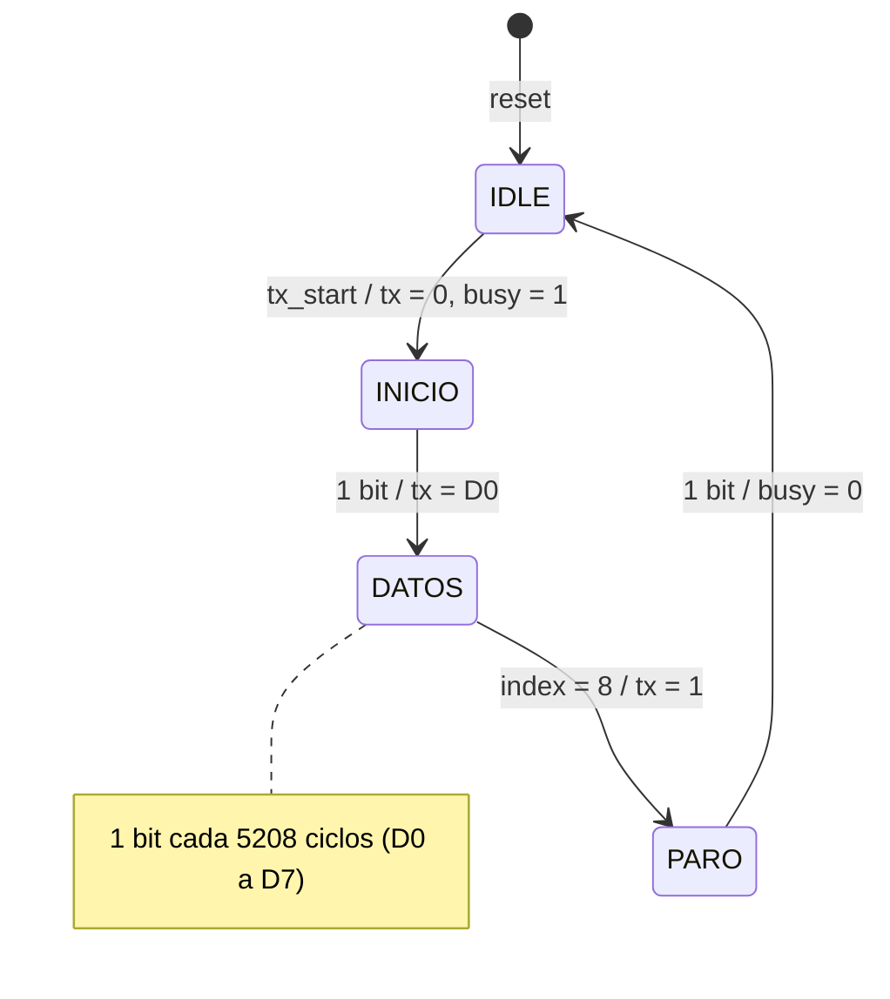
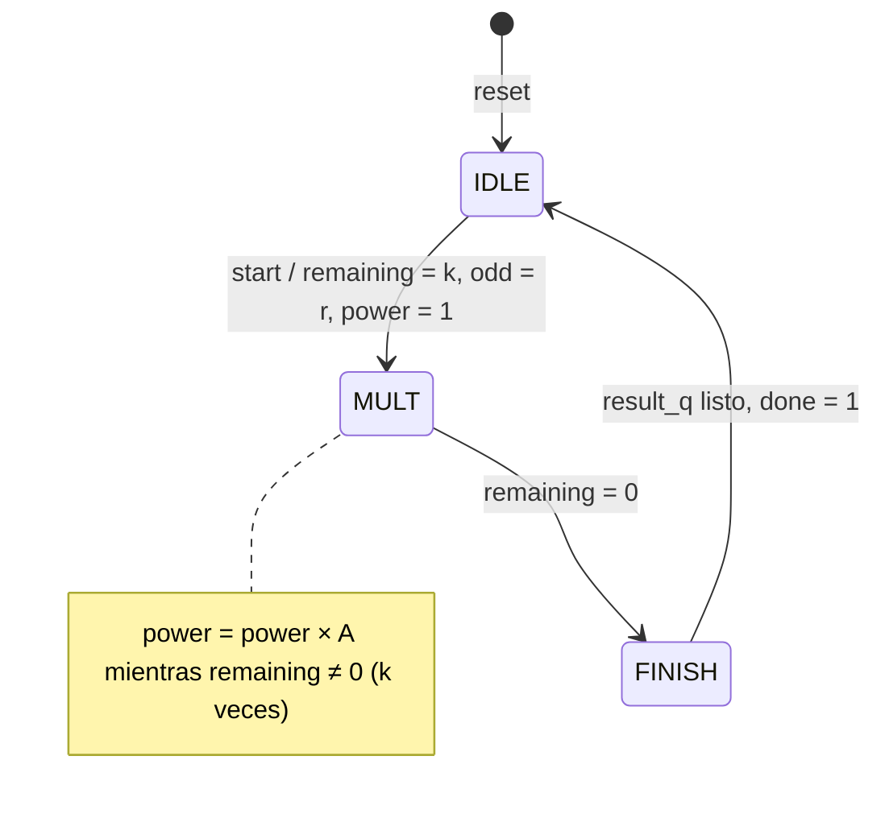
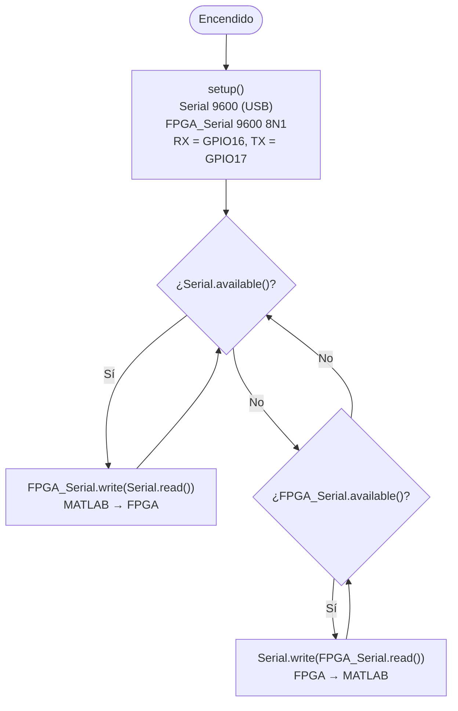
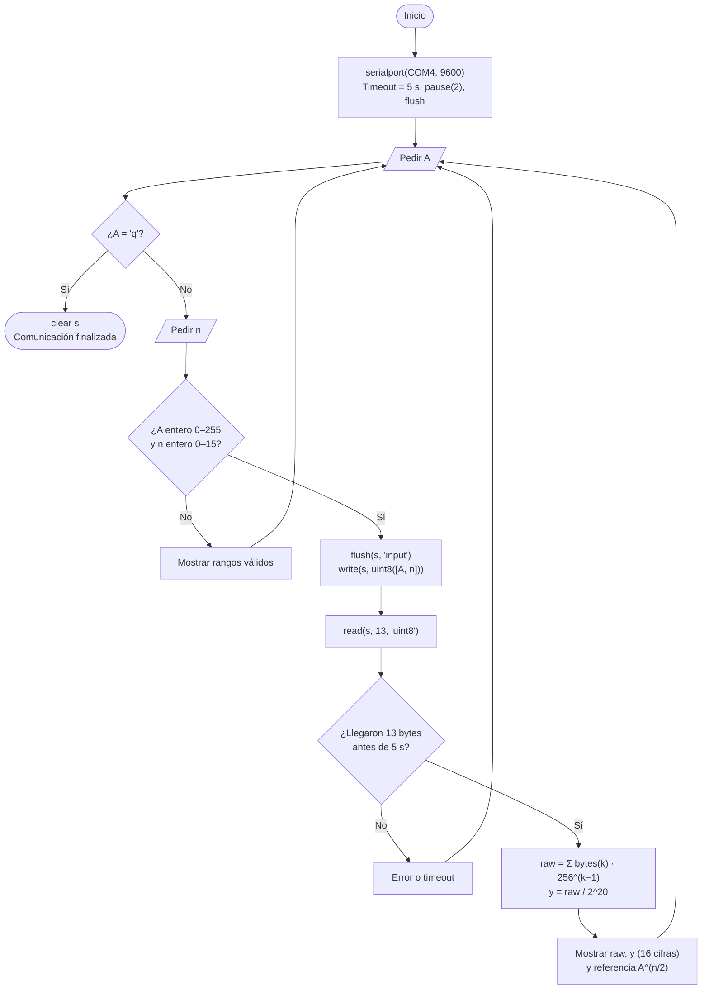
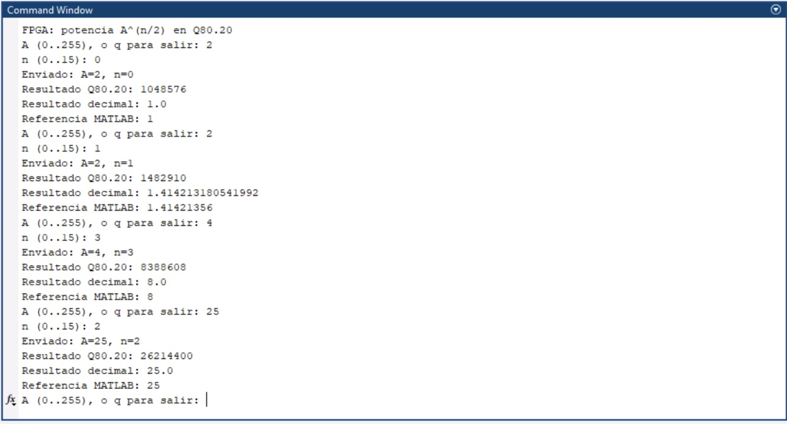
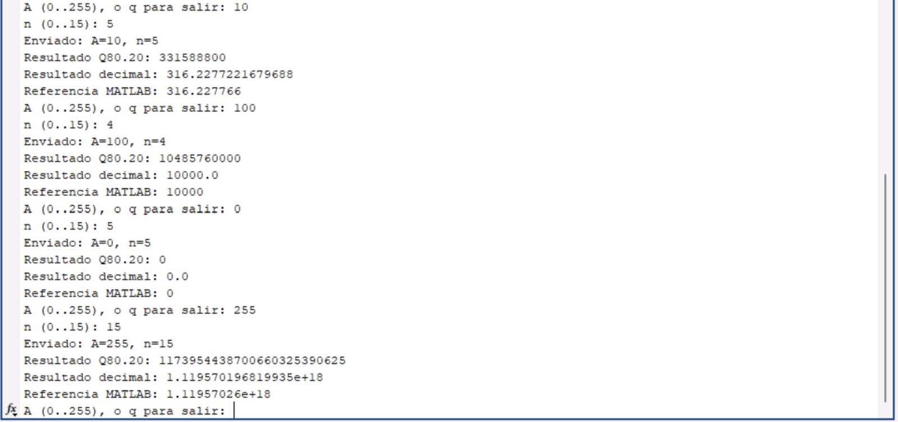

# Práctica 4 · Comunicación UART bidireccional MATLAB ↔ ESP32 ↔ FPGA DE10-Lite

Cálculo de $A^{n/2}$ en punto fijo **Q80.20** en una FPGA MAX 10, con MATLAB como interfaz de usuario y un ESP32 como puente USB–UART.

**Universidad de las Américas Puebla (UDLAP)**, Laboratorio de Sistemas Embebidos

**Equipo:** Abril Morales Huerta · Anellisse Herrera Maldonado · José Manuel Daniel


---

## Índice

1. [Objetivo](#1-objetivo)
2. [Estado del arte / Marco teórico](#2-estado-del-arte--marco-teórico)
3. [Planteamiento del experimento](#3-planteamiento-del-experimento)
   - [3.1 Materiales y software](#31-materiales-y-software)
   - [3.2 Organización del diseño](#32-organización-del-diseño)
   - [3.3 Asignación de entradas y salidas](#33-asignación-de-entradas-y-salidas)
   - [3.4 Implementación](#34-implementación)
   - [3.5 Máquinas de estados y diagramas](#35-máquinas-de-estados-y-diagramas)
   - [3.6 Configuración del proyecto](#36-configuración-del-proyecto)
4. [Casos de estudio o pruebas](#4-casos-de-estudio-o-pruebas)
5. [Análisis de resultados](#5-análisis-de-resultados)
6. [Conclusiones](#6-conclusiones)
7. [Referencias](#referencias)

### Estructura del repositorio

```
.
├── README.md                 # Este documento (reporte técnico completo)
├── hdl/                      # Diseño Verilog sintetizable
│   ├── top_uart_de10lite.v
│   ├── uart_rx.v
│   ├── uart_tx.v
│   └── potencia_q8020.v
├── sim/                      # Simulación en Active-HDL
│   ├── tb_potencia_q8020.v
│   ├── sim1.awc
│   └── sim1.asdb
├── quartus/
│   └── asignacion_pines.tcl  # Dispositivo, entidad principal y pines
├── esp32/puente_uart/
│   └── puente_uart.ino       # Puente transparente USB <-> UART2
├── matlab/
│   └── potencia_fpga.m       # Envío de A y n, recepción y verificación
├── docs/                     # Documentación por tema e imágenes (docs/img)
└── reporte/
    └── reporte_practica4.tex # Portada, resumen, cuestionario y referencias
```

---

## 1. Objetivo

Diseñar e implementar un sistema de comunicación serial bidireccional entre una computadora y la tarjeta FPGA DE10-Lite mediante el protocolo UART, a **9600 baudios con formato 8N1**. Se usa un **ESP32 como puente transparente USB–UART** y un **script de MATLAB** para enviar y recibir los datos.

La FPGA incorpora un bloque de procesamiento que recibe una base **A** (0 a 255) y un exponente **n** (0 a 15), calcula $A^{n/2}$ en formato de punto fijo **Q80.20** y envía el resultado de regreso a la computadora para verificarlo.

| Parámetro | Valor |
|---|---|
| Velocidad / formato | 9600 baudios, 8N1 |
| Reloj de la FPGA | 50 MHz → 5208 ciclos por bit |
| Entrada | 2 bytes: `A`, `n` |
| Salida | 13 bytes en *little-endian* (100 bits, Q80.20) |
| Latencia del cálculo | $k+2$ ciclos, máximo 9 ciclos (180 ns) |
| Tiempo por operación | ≈ 15.6 ms (casi todo es la UART) |

---

## 2. Estado del arte / Marco teórico

### 2.1 Comunicación serial UART

UART (*Universal Asynchronous Receiver Transmitter*) es una comunicación serial **asíncrona**. El transmisor y el receptor no comparten reloj, así que los dos deben estar configurados con el mismo *baud rate*.

Cuando no se transmite nada, la línea está en alto. Cada byte viaja dentro de una trama: un bit de inicio en 0, los 8 bits de datos empezando por el LSB, un bit de paridad opcional y uno o más bits de paro en 1. Con **8N1**, cada byte ocupa 10 periodos de bit.

Esta es la trama del byte `0x04`, que en este sistema corresponde a A = 4:

```
        Reposo Inicio D0  D1  D2  D3  D4  D5  D6  D7  Paro Reposo
línea:    1      0     0   0   1   0   0   0   0   0    1     1
        ‾‾‾‾‾‾\_______________/‾‾‾\___________________/‾‾‾‾‾‾‾‾‾‾‾
```

### 2.2 Comunicación bidireccional

Cada dispositivo tiene una salida **TX** y una entrada **RX**. Por eso la conexión es **cruzada**: el TX de uno va al RX del otro. Además, deben compartir **GND** para que los dos midan los niveles lógicos con la misma referencia.

En este sistema, la comunicación es de petición y respuesta: la PC envía 2 bytes y la FPGA contesta con 13.

### 2.3 ESP32 como puente USB–UART

El ESP32 tiene varios controladores UART en hardware. **UART0** (`Serial`) se comunica con la PC por USB, que la ve como un puerto COM virtual. **UART2** (`FPGA_Serial`) se comunica con la FPGA por GPIO16 (RX) y GPIO17 (TX).

Como reenvía cada byte sin modificarlo, desde MATLAB parece que la FPGA está conectada directamente a un puerto serial. El ESP32 y la DE10-Lite trabajan a **3.3 V**, así que se conectan sin convertidores de nivel.

```
MATLAB ⇄ USB ⇄ ESP32 ⇄ UART ⇄ FPGA
```

### 2.4 Temporización de la UART en la FPGA

La FPGA no tiene un reloj de 9600 Hz. En su lugar, cuenta ciclos del reloj de 50 MHz:

$$N = \frac{f_{clk}}{\text{baud}} = \frac{50\,000\,000}{9600} \approx 5208 \text{ ciclos por bit}$$

Como la división se trunca, la velocidad real es

$$\text{baud}_{real} = \frac{50\,000\,000}{5208} \approx 9600.61,$$

con un error de solo **0.0064 %**, muy por debajo de la tolerancia de una UART. El receptor espera **medio bit (2604 ciclos)** después del flanco de inicio. Así, todas las muestras siguientes caen cerca del centro de cada bit.

### 2.5 Representación en punto fijo Q80.20

El resultado ocupa 100 bits: 80 de parte entera y 20 fraccionarios. El valor real se obtiene dividiendo la palabra almacenada `q` entre $2^{20}$:

$$y = \frac{q}{2^{20}}, \qquad \text{resolución} = 2^{-20} \approx 9.54\times10^{-7}$$

| Valor real | Palabra Q80.20 |
|---|---|
| 1 | 1 048 576 (`0x100000`) |
| 8 | 8 388 608 (`0x800000`) |
| √2 | 1 482 910 (`0x16A09E`) |

El resultado se envía en 13 bytes, empezando por el menos significativo. Como 13 × 8 = 104, `B12` solo contiene los bits 99:96.

```
bit   99 ........................ 20 19 ............ 0
      [      parte entera (80)     ][ fracción (20)  ]
byte   B12 | B11 | ... | B3 | B2 | B1 | B0      (B0 se envía primero)
```

### 2.6 Cálculo de $A^{n/2}$

El exponente se separa en su parte par y su bit menos significativo:

$$n = 2k + r, \quad k = \lfloor n/2 \rfloor, \quad r\in\{0,1\} \qquad\Rightarrow\qquad A^{n/2} = A^{k}\left(\sqrt{A}\right)^{r}$$

- $A^k$ se obtiene con $k$ multiplicaciones sucesivas, a lo más 7.
- $\sqrt{A}$ sale de la raíz cuadrada entera $\lfloor\sqrt{A\cdot 2^{40}}\rfloor = \lfloor\sqrt{A}\cdot 2^{20}\rfloor$, que ya tiene 20 bits fraccionarios. Se calcula con el método binario **dígito por dígito**: en cada iteración se bajan dos bits del radicando al residuo y se compara el residuo con `4·raíz + 1`.

El valor máximo posible es $255^{7.5} \approx 1.12\times10^{18} < 2^{60}$, así que cabe de sobra en los 80 bits enteros.

---

## 3. Planteamiento del experimento

El sistema tiene tres partes:

- **MATLAB** pide A y n, los envía como 2 bytes y espera 13 bytes de respuesta.
- **El ESP32** reenvía los bytes en ambos sentidos.
- **La FPGA** recibe los bytes, calcula $A^{n/2}$ y transmite el resultado.

Primero simulamos el módulo de cálculo en Active-HDL. Después implementamos el diseño en la tarjeta y probamos la comunicación completa desde MATLAB.

### 3.1 Materiales y software

| Hardware | Software |
|---|---|
| Tarjeta FPGA DE10-Lite (MAX 10 10M50DAF484C7G) | Intel Quartus Prime Lite 21.1.1 |
| Cable USB Blaster | Active-HDL (simulación) |
| Módulo ESP32 y cable USB | Arduino IDE con soporte para ESP32 |
| Cables Dupont | MATLAB con `serialport` y Symbolic Math Toolbox |
| Computadora | — |

### 3.2 Organización del diseño



| Módulo | Archivo | Función |
|---|---|---|
| `top_uart_de10lite` | [`hdl/top_uart_de10lite.v`](hdl/top_uart_de10lite.v) | Integra los módulos, recibe A y n, inicia el cálculo y envía los 13 bytes. |
| `uart_rx` | [`hdl/uart_rx.v`](hdl/uart_rx.v) | Sincroniza la línea, detecta el inicio, muestrea 8 bits y valida el bit de paro. |
| `uart_tx` | [`hdl/uart_tx.v`](hdl/uart_tx.v) | Genera la trama 8N1 e indica `busy` mientras transmite. |
| `potencia_q8020` | [`hdl/potencia_q8020.v`](hdl/potencia_q8020.v) | Calcula $A^k(\sqrt{A})^r$ y entrega el resultado en Q80.20. |

El recorrido de los datos es el siguiente: `uart_rx` entrega cada byte con un pulso en `rx_done`. La FSM principal guarda el primer byte como A y el segundo como n, y activa `calc_start`. Cuando llega `calc_done`, copia el resultado en `result_reg` y lo envía byte por byte con `uart_tx`.

📄 [Ver diagrama RTL (PDF)](img/RTL.practica4.pdf)

### 3.3 Asignación de entradas y salidas

**Conexión entre el ESP32 y la FPGA**

| ESP32 | DE10-Lite | Función |
|---|---|---|
| GPIO17 (TX2) | `UART_RX` | Datos de MATLAB hacia la FPGA |
| GPIO16 (RX2) | `UART_TX` | Resultado de la FPGA hacia MATLAB |
| GND | GND | Referencia común |

**Señales del módulo principal**

| Señal | Dirección | Recurso | Pin | Función |
|---|---|---|---|---|
| `CLOCK_50` | Entrada | Reloj de 50 MHz | `PIN_P11` | Reloj principal |
| `RESET_N` | Entrada | KEY[0] | `PIN_B8` | Reinicio activo en bajo (`reset = ~RESET_N`) |
| `UART_RX` | Entrada | GPIO | _completar_ | Recepción desde el ESP32 |
| `UART_TX` | Salida | GPIO | _completar_ | Transmisión hacia el ESP32 |

Las asignaciones están en [`quartus/asignacion_pines.tcl`](quartus/asignacion_pines.tcl).

### 3.4 Implementación

#### 3.4.1 Receptor UART (`uart_rx`)

La línea `rx` es asíncrona respecto al reloj de la FPGA, así que primero pasa por un **sincronizador de dos flip-flops**. Con el reset, ambos quedan en 1, que es el nivel de reposo:

```verilog
meta <= rx;
sync <= meta;
```

Los tiempos se calculan a partir de los parámetros:

```verilog
localparam integer CLKS_PER_BIT = CLK_FREQ / BAUD_RATE;  // 5208
localparam integer HALF_BIT     = CLKS_PER_BIT / 2;      // 2604
```

En `START`, el receptor cuenta medio bit y revisa la línea otra vez. Si volvió a 1, se trata de un pulso espurio y la trama se descarta:

```verilog
START: begin
    if (count == HALF_BIT-1) begin
        count <= 0;
        if (!sync) state <= DATA;
        else       state <= IDLE;
    end else
        count <= count + 1'b1;
end
```

En `DATA` guarda cada bit en su posición, empezando por el LSB (`shift[bit_index] <= sync`). En `STOP` solo entrega el byte si el bit de paro es 1:

```verilog
if (sync) begin
    data_out   <= shift;
    data_valid <= 1;   // pulso de un ciclo
end
```

#### 3.4.2 Transmisor UART (`uart_tx`)

Al recibir `tx_start`, arma la trama de 10 bits y baja la línea de inmediato para el bit de inicio:

```verilog
frame <= {1'b1, data_in, 1'b0};   // paro | datos | inicio
tx    <= 0;
busy  <= 1;
```

Cada 5208 ciclos, desplaza el registro y saca el siguiente bit. Por la izquierda entran unos, así que la línea termina en reposo:

```verilog
index <= index + 1'b1;
frame <= {1'b1, frame[9:1]};
tx    <= frame[1];
```

`busy` se mantiene activo durante los 10 bits.

#### 3.4.3 Módulo de cálculo (`potencia_q8020`)

```verilog
IDLE:   remaining <= n[3:1];  odd <= n[0];  power <= 80'd1;   // k y r
MULT:   power <= power * a_reg;                               // se repite k veces
FINISH: result_q <= odd ? odd_product[99:0]   // A^k * sqrt(A) en Q20
                        : {power, 20'd0};     // A^k * 2^20
```

```verilog
wire [31:0]  root_q20    = isqrt64({16'd0, a_reg, 40'd0});  // floor(sqrt(A)*2^20)
wire [111:0] odd_product = power * root_q20;
```

`power` es entero y `root_q20` ya trae 20 bits fraccionarios, así que su producto queda directamente en Q80.20. Cuando n es par, basta con agregar 20 ceros a la derecha. `done` se activa durante un ciclo cuando el resultado es válido.

#### 3.4.4 Control principal (`top_uart_de10lite`)

`SEND` siempre transmite el byte bajo de `result_reg`. Después de cada byte, el registro se desplaza 8 bits, así que el envío es *little-endian*:

```verilog
SEND:      if (!tx_busy) begin tx_data <= result_reg[7:0]; tx_start <= 1; state <= WAIT_BUSY; end
WAIT_BUSY: if (tx_busy)  state <= WAIT_IDLE;
WAIT_IDLE: if (!tx_busy) begin
               result_reg <= result_reg >> 8;
               if (byte_index == 12) state <= WAIT_A;
               else begin byte_index <= byte_index + 1'b1; state <= SEND; end
           end
```

#### 3.4.5 Programa del ESP32

Archivo: [`esp32/puente_uart/puente_uart.ino`](esp32/puente_uart/puente_uart.ino)

```cpp
HardwareSerial FPGA_Serial(2);

void setup() {
  Serial.begin(9600);                                  // USB  <-> PC
  FPGA_Serial.begin(9600, SERIAL_8N1, 16, 17);         // UART2 <-> FPGA
}

void loop() {
  while (Serial.available() > 0)      FPGA_Serial.write(Serial.read());   // MATLAB -> FPGA
  while (FPGA_Serial.available() > 0) Serial.write(FPGA_Serial.read());   // FPGA -> MATLAB
}
```

A diferencia del ejemplo de la guía, este programa **no imprime un mensaje de inicio**. MATLAB toma como resultado todos los bytes que llegan, así que un texto extra se mezclaría con la respuesta.

#### 3.4.6 Script de MATLAB

Archivo: [`matlab/potencia_fpga.m`](matlab/potencia_fpga.m)

```matlab
s = serialport("COM4", 9600);  s.Timeout = 5;  pause(2);  flush(s);
...
flush(s, 'input');
write(s, uint8([A, n]), 'uint8');
bytes = read(s, 13, 'uint8');

raw = sym(0);
for k = 1:13
    raw = raw + sym(double(bytes(k))) * sym(256)^(k-1);   % little-endian
end
y = raw / sym(2)^20;                                       % Q80.20 -> decimal
```

El resultado se reconstruye con aritmética simbólica (`sym`) porque 100 bits no caben con exactitud en un `double` (53 bits de mantisa) ni en un `uint64`.

### 3.5 Máquinas de estados y diagramas

Cada módulo de la FPGA es una máquina de estados sincronizada con el reloj de 50 MHz y con reset asíncrono. En los diagramas, si ninguna transición se cumple, **el estado se mantiene** en el siguiente ciclo, por ejemplo mientras espera un dato o mientras cuenta ciclos. Esas autotransiciones se omiten para no saturar los dibujos.

#### 3.5.1 Vista general de una operación



#### 3.5.2 Control principal: `top_uart_de10lite`



| Estado | Qué hace | Sale cuando… |
|---|---|---|
| `WAIT_A` | Espera el primer byte. | `rx_done`: guarda A en `a_reg`. |
| `WAIT_N` | Espera el segundo byte. | `rx_done`: guarda n en `n_reg`. |
| `CALC` | Activa `calc_start` durante un ciclo. | Siempre, al ciclo siguiente. |
| `WAIT_CALC` | Espera el resultado. | `calc_done`: copia los 100 bits en `result_reg`. |
| `SEND` | Carga el byte bajo y pulsa `tx_start`. | El transmisor está libre. |
| `WAIT_BUSY` | Espera la confirmación del transmisor. | `tx_busy` sube. |
| `WAIT_IDLE` | Espera el fin de la trama y desplaza `result_reg` 8 bits. | `tx_busy` baja: sigue el próximo byte o termina. |

> **¿Por qué existe `WAIT_BUSY`?** `tx_start` se registra y `tx_busy` sube un ciclo después. Sin este estado, `WAIT_IDLE` vería `tx_busy = 0` antes de que el transmisor arrancara y se saltaría un byte.

#### 3.5.3 Receptor: `uart_rx`



| Estado | Espera | Acción |
|---|---|---|
| `IDLE` | Un 0 en la línea. | Reinicia `count` y `bit_index`. |
| `START` | 2604 ciclos (medio bit). | Confirma que el inicio sigue en 0, así las muestras siguientes caen al centro de cada bit. |
| `DATA` | 5208 ciclos por bit, 8 veces. | Guarda cada bit en `shift`, empezando por el LSB. |
| `STOP` | 5208 ciclos. | Si el bit de paro es 1, entrega el byte y pulsa `data_valid`. |

```
línea   ‾‾‾‾\____|____|____|____|____|____|____|____|____/‾‾‾‾
              Inicio D0   D1   D2   D3   D4   D5   D6   D7  Paro
muestra         ↑    ↑    ↑    ↑    ↑    ↑    ↑    ↑    ↑    ↑
              START  └────────────── DATA ──────────────┘  STOP
             (½ bit)          (1 bit entre muestras)
```

#### 3.5.4 Transmisor: `uart_tx`

El código no tiene un registro `state`. Su estado lo forman `busy` y el contador `index`, y el diagrama muestra esos estados implícitos.



| Estado implícito | `busy` | `index` | Nivel de `tx` | Duración |
|---|:---:|:---:|---|---|
| `IDLE` | 0 | — | 1 (reposo) | Hasta `tx_start` |
| `INICIO` | 1 | 0 | 0 | 1 bit |
| `DATOS` | 1 | 1 – 8 | D0 … D7 | 8 bits |
| `PARO` | 1 | 9 | 1 | 1 bit |

#### 3.5.5 Cálculo: `potencia_q8020`



| Estado | Ciclos | Acción |
|---|:---:|---|
| `IDLE` | — | Al recibir `start`, separa $n = 2k + r$. |
| `MULT` | $k+1$ | Multiplica `power` por A hasta que `remaining = 0`, es decir, calcula $A^k$. |
| `FINISH` | 1 | Si n es impar, multiplica por $\lfloor\sqrt{A}\cdot2^{20}\rfloor$. Si es par, desplaza 20 bits. Pulsa `done`. |

La raíz `root_q20` es **combinacional**: se calcula en paralelo mientras la máquina está en `MULT`. Este es el ejemplo ciclo a ciclo con A = 10 y n = 5 (k = 2, r = 1):

| Ciclo | Estado | `remaining` | `power` | Salida |
|:---:|---|:---:|---:|---|
| 0 | `IDLE` (`start`) | — | — | Carga A = 10, k = 2, r = 1 |
| 1 | `MULT` | 2 | 1 | — |
| 2 | `MULT` | 1 | 10 | — |
| 3 | `MULT` | 0 | 100 | Pasa a `FINISH` |
| 4 | `FINISH` | 0 | 100 | `result_q` = 100 × 3 315 888 = 331 588 800, `done` = 1 |

$331\,588\,800 / 2^{20} = 316.2277…$ ✔

#### 3.5.6 Diagrama de flujo del ESP32



#### 3.5.7 Diagrama de flujo del script de MATLAB



### 3.6 Configuración del proyecto

**Quartus Prime Lite 21.1**
1. Crea un proyecto para el dispositivo **10M50DAF484C7G** y agrega los cuatro archivos de `hdl/`.
2. Define `top_uart_de10lite` como entidad principal.
3. Completa los pines GPIO en `quartus/asignacion_pines.tcl` y ejecútalo desde *Tools → Tcl Scripts*.
4. Compila y programa la tarjeta con el USB Blaster.

**Active-HDL**
1. Agrega `hdl/potencia_q8020.v` y `sim/tb_potencia_q8020.v` al diseño.
2. Selecciona `tb_potencia_q8020` como unidad principal y simula. La vista de ondas guardada es `sim/sim1.awc`.

**Arduino IDE**
1. Instala el soporte para tarjetas ESP32 y selecciona tu placa y su puerto.
2. Carga `esp32/puente_uart/puente_uart.ino` y conecta los cables como en la [sección 3.3](#33-asignación-de-entradas-y-salidas).

**MATLAB**
1. Cambia `PORT` en `matlab/potencia_fpga.m` al puerto COM del ESP32 y cierra el Monitor Serial de Arduino.
2. Ejecuta el script e ingresa A y n. Escribe `q` para salir.

---

## 4. Casos de estudio o pruebas

### 4.1 Simulación del módulo de cálculo

El banco de pruebas [`sim/tb_potencia_q8020.v`](sim/tb_potencia_q8020.v) usa un reloj de 20 ns (50 MHz) y mantiene el reset durante 3 ciclos. Después aplica 5 casos: en cada uno pulsa `start`, espera `done` y compara `result_q` con el valor esperado.

| A | n | $A^{n/2}$ | Q80.20 esperado | Ciclos |
|---:|---:|---:|---:|---:|
| 4 | 3 | 8 | 8 388 608 | 3 |
| 9 | 3 | 27 | 28 311 552 | 3 |
| 16 | 3 | 64 | 67 108 864 | 3 |
| 4 | 7 | 128 | 134 217 728 | 5 |
| 2 | 0 | 1 | 1 048 576 | 2 |


Salida de la consola del simulador (la simulación termina a los 580 ns):

```
OK A=4 n=3 Q=8388608
OK A=9 n=3 Q=28311552
OK A=16 n=3 Q=67108864
OK A=4 n=7 Q=134217728
OK A=2 n=0 Q=1048576
```

### 4.2 Carga del programa en el ESP32


### 4.3 Conexión física

El GPIO17 del ESP32 va a `UART_RX`, el GPIO16 a `UART_TX`, y las dos tarjetas comparten GND. El ESP32 se conecta a la computadora por USB.


### 4.4 Pruebas desde MATLAB

Para cada caso, el script muestra los valores enviados, el entero Q80.20 recibido, su valor decimal y la referencia de MATLAB. La última columna muestra los bytes esperados en el orden de llegada; los que no aparecen son `00`.

| A | n | Q80.20 | Decimal | Bytes B0, B1, … |
|---:|---:|---:|---:|---|
| 2 | 0 | 1 048 576 | 1 | `00 00 10` |
| 2 | 1 | 1 482 910 | 1.4142131805 | `9E A0 16` |
| 4 | 3 | 8 388 608 | 8 | `00 00 80` |
| 25 | 2 | 26 214 400 | 25 | `00 00 90 01` |
| 10 | 5 | 331 588 800 | 316.2277221680 | `C0 A4 C3 13` |
| 100 | 4 | 10 485 760 000 | 10 000 | `00 00 00 71 02` |
| 0 | 5 | 0 | 0 | `00` |
| 255 | 15 | 1.17395 × 10²⁴ | 1 119 570 196 819 935 155.29 | `21 99 34 FB 0F A9 98 32 98 F8` |

Ejemplo de la consola:

```
A (0..255), o q para salir: 10
n (0..15): 5
Enviado: A=10, n=5
Resultado Q80.20: 331588800
Resultado decimal: 316.2277221679688
Referencia MATLAB: 316.227766
```





### 4.5 Video de funcionamiento

_(agregar enlace)_

---

## 5. Análisis de resultados

### 5.1 Módulo de cálculo

| Prueba | Resultado observado | Interpretación |
|---|---|---|
| Exponente impar | (4,3), (9,3), (16,3) y (4,7) coinciden con el valor esperado. | La raíz y la multiplicación por $A^k$ producen el resultado en Q80.20. |
| Exponente cero | (2,0) produce 1 048 576. | Corresponde a 1 en Q80.20. |
| Señal `done` | Se activa durante un ciclo al terminar cada caso. | Indica cuándo el resultado es válido. |

**Hallazgo principal:** los 5 casos reportan `OK`.

### 5.2 Precisión del formato Q80.20

- **n par:** el resultado es $A^k\cdot2^{20}$, así que es **exacto**.
- **n impar:** $\sqrt{A}$ se trunca a 20 bits antes de multiplicarse por $A^k$:

$$e_r = \frac{\delta}{\sqrt{A}\cdot 2^{20}} < \frac{1}{\sqrt{2}\cdot 2^{20}} \approx 6.7\times10^{-7}, \qquad 0\le\delta<1$$

Al revisar todas las bases de 2 a 255, el mayor error relativo es **5.0 × 10⁻⁷** (A = 3). El resultado nunca supera el valor exacto.

| A | n | Exacto | FPGA | Error relativo |
|---:|---:|---:|---:|---:|
| 2 | 1 | 1.414213562 | 1.414213181 | 2.7 × 10⁻⁷ |
| 3 | 5 | 15.58845727 | 15.58845448 | 5.0 × 10⁻⁷ |
| 10 | 5 | 316.2277660 | 316.2277222 | 1.4 × 10⁻⁷ |
| 255 | 15 | 1.119570259 × 10¹⁸ | 1.119570197 × 10¹⁸ | 5.6 × 10⁻⁸ |

> Los 20 bits fraccionarios fijan la resolución de la raíz, pero el **error absoluto** crece con $A^k$. Para $255^{7.5}$ es de unos 6 × 10¹⁰, aunque el error relativo sea de solo 5.6 × 10⁻⁸. Además, la referencia de MATLAB usa `double`, así que para resultados mayores que 2⁵³ puede perder las últimas cifras.

### 5.3 Comunicación y tiempos

El divisor de 5208 ciclos da un error de velocidad de 0.0064 %. Cada byte ocupa 10 bits.

| Etapa | Bits | Tiempo |
|---|---:|---:|
| Envío de A y n (2 bytes) | 20 | 2.08 ms |
| Cálculo (peor caso) | — | 180 ns |
| Envío del resultado (13 bytes) | 130 | 13.54 ms |
| **Total** | **150** | **≈ 15.6 ms** |

Casi todo el tiempo se va en la comunicación serial. El cálculo es despreciable y el total queda muy por debajo del `Timeout` de 5 s del script.

### 5.4 Implementación física

| A | n | Esperado (decimal) | Obtenido | Observación |
|---:|---:|---|---|---|
| 2 | 0 | 1 | _completar_ | |
| 2 | 1 | 1.4142131805 | _completar_ | |
| 4 | 3 | 8 | _completar_ | |
| 10 | 5 | 316.2277221680 | _completar_ | |
| 255 | 15 | 1.11957019682 × 10¹⁸ | _completar_ | |

- **Orden de los bytes:** la FPGA envía primero el byte menos significativo y MATLAB multiplica el byte k por $256^{k-1}$. Como los dos usan el mismo orden, el entero reconstruido coincide con el calculado en la FPGA.
- **Validación de entradas:** el módulo solo usa `n[3:0]`, así que la validación de MATLAB (n ≤ 15) es necesaria.

### 5.5 Alcance de los resultados

- La simulación cubre 5 casos con resultado exacto. Las raíces irracionales y el exponente máximo se revisaron en la tarjeta.
- `uart_rx` y `uart_tx` no se simularon por separado. Su funcionamiento se verificó con la comunicación completa.
- La FSM principal no tiene tiempo límite. Si solo llega A, se queda en `WAIT_N` hasta recibir otro byte o un reset.
- `isqrt64` es combinacional. Conviene confirmar en el *Timing Analyzer* de Quartus que cumple a 50 MHz.

---

## 6. Conclusiones

**Logros de la implementación**
- **Comunicación UART:** receptor y transmisor 8N1 a 9600 baudios a partir del reloj de 50 MHz, con 5208 ciclos por bit.
- **Protocolo de petición y respuesta:** 2 bytes de entrada y 13 de salida, coordinados por una FSM que respeta la señal `busy` del transmisor.
- **Cálculo en punto fijo:** $A^{n/2}$ con multiplicaciones sucesivas y una raíz cuadrada entera. Los 5 casos de la simulación dieron el valor correcto.
- **Verificación desde MATLAB:** el resultado de 100 bits se reconstruye con aritmética simbólica y se compara con una referencia.

**Aprendizajes principales**
- **Importancia del baud rate:** sin reloj compartido, el receptor depende de que los dos extremos usen la misma velocidad. Un error de temporización se acumula a lo largo de la trama. Por eso configuramos 9600 baudios en MATLAB, en las dos UART del ESP32 y en la FPGA.
- **Comunicación bidireccional:** permite que la PC configure la operación y verifique el resultado, así que la FPGA funciona como un coprocesador que se prueba desde software.
- **Papel del ESP32:** reemplazó a un convertidor USB–UART dedicado y se conectó directo a 3.3 V. El puente debe ser transparente, porque cualquier byte extra se mezcla con la respuesta.
- **Ventajas de MATLAB:** facilitó generar casos de prueba, validar entradas, reconstruir 100 bits y comparar con una referencia.
- **Punto fijo:** el número de bits fraccionarios fija la resolución, y el error de un resultado intermedio se amplifica en las operaciones siguientes.

**Alcance de la verificación**
- No hay simulaciones aisladas de los módulos UART.
- Las pruebas no cubren todas las combinaciones de A y n.
- El diseño no recupera automáticamente una operación incompleta.

---

## Referencias

1. M. M. Mano, *Diseño digital*.
2. Terasic, *DE10-Lite User Manual*, 2020.
3. Espressif Systems, [*ESP32 Technical Reference Manual*](https://www.espressif.com/sites/default/files/documentation/esp32_technical_reference_manual_en.pdf), capítulo UART Controller.
4. MathWorks, [*serialport*](https://www.mathworks.com/help/matlab/ref/serialport.html).
5. S. Brown y Z. Vranesic, *Fundamentals of Digital Logic with Verilog Design*, 3.ª ed., McGraw-Hill, 2014.
6. Texas Instruments, *Interface Circuits for TIA/EIA-232-F*, SLLA037.
