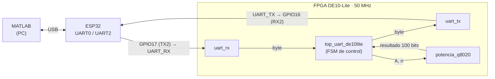
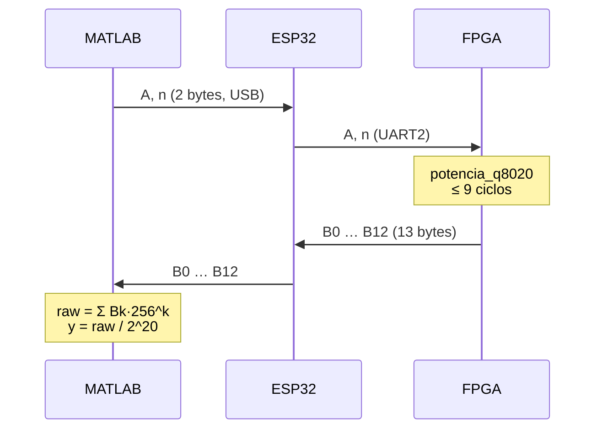

# Práctica 4 · Comunicación UART bidireccional MATLAB ↔ ESP32 ↔ FPGA DE10-Lite

Cálculo de $A^{n/2}$ en punto fijo **Q80.20** dentro de una FPGA MAX 10, con MATLAB como interfaz de usuario y un ESP32 como puente USB–UART.

**Universidad de las Américas Puebla (UDLAP)**, Laboratorio de Sistemas Embebidos

**Equipo:** Abril Morales Huerta · Anellisse Herrera Maldonado · José Manuel Daniel Morales


---

## Contenido

1. [Descripción](#descripción)
2. [Arquitectura](#arquitectura)
3. [Protocolo de comunicación](#protocolo-de-comunicación)
4. [Estructura del repositorio](#estructura-del-repositorio)
5. [Cómo reproducir la práctica](#cómo-reproducir-la-práctica)
6. [Resultados](#resultados)
7. [Documentación detallada](#documentación-detallada)
8. [Referencias](#referencias)

---

## Descripción

Desde MATLAB se envía una base **A** (0 a 255) y un exponente **n** (0 a 15). La FPGA recibe ambos bytes por UART, calcula

$$y = A^{n/2}$$

en formato Q80.20 (80 bits enteros y 20 fraccionarios) y regresa el resultado de **100 bits dividido en 13 bytes**. MATLAB reconstruye el valor, lo convierte a decimal y lo compara con `A^(n/2)` calculado por software.

| Parámetro | Valor |
|---|---|
| Velocidad | 9600 baudios |
| Formato | 8N1 (8 bits, sin paridad, 1 bit de paro) |
| Reloj de la FPGA | 50 MHz → 5208 ciclos por bit (error 0.0064 %) |
| Entrada | 2 bytes: `A`, `n` |
| Salida | 13 bytes, *little-endian*, Q80.20 |
| Latencia del cálculo | $k+2$ ciclos, máximo 9 ciclos (180 ns) |
| Tiempo por operación | ≈ 15.6 ms (dominado por la UART) |

## Arquitectura



> El ESP32 y la FPGA comparten **GND**. Ambos trabajan a 3.3 V, así que no se necesitan convertidores de nivel.

| Módulo | Archivo | Función |
|---|---|---|
| `top_uart_de10lite` | [`hdl/top_uart_de10lite.v`](hdl/top_uart_de10lite.v) | Integra los módulos, recibe `A` y `n`, inicia el cálculo y envía los 13 bytes. |
| `uart_rx` | [`hdl/uart_rx.v`](hdl/uart_rx.v) | Sincronizador de 2 FF, detección del bit de inicio a mitad de bit, muestreo de 8 bits y validación del bit de paro. |
| `uart_tx` | [`hdl/uart_tx.v`](hdl/uart_tx.v) | Genera la trama 8N1 e indica `busy` mientras transmite. |
| `potencia_q8020` | [`hdl/potencia_q8020.v`](hdl/potencia_q8020.v) | Calcula $A^{k}\,(\sqrt{A})^{r}$ con $n = 2k + r$ y entrega el resultado en Q80.20. |

## Protocolo de comunicación



El resultado se transmite empezando por el byte menos significativo:

```
bit   99 ........................ 20 19 ............ 0
      [      parte entera (80)     ][ fracción (20)  ]
byte   B12 | B11 | ... | B3 | B2 | B1 | B0      (B0 se envía primero)
```

`B12` solo contiene los bits 99:96, porque 13 × 8 = 104 bits.

## Estructura del repositorio

```
.
├── README.md
├── hdl/                      # Diseño Verilog sintetizable
│   ├── top_uart_de10lite.v
│   ├── uart_rx.v
│   ├── uart_tx.v
│   └── potencia_q8020.v
├── sim/                      # Simulación (Active-HDL)
│   ├── tb_potencia_q8020.v
│   ├── sim1.awc              # configuración de la vista de ondas
│   └── sim1.asdb             # base de datos de la simulación
├── quartus/
│   └── asignacion_pines.tcl  # dispositivo, entidad principal y pines
├── esp32/
│   └── puente_uart/
│       └── puente_uart.ino   # puente transparente USB <-> UART2
├── matlab/
│   └── potencia_fpga.m       # envío de A y n, recepción y verificación
├── docs/                     # Documentación técnica detallada
│   ├── 01_fundamentos.md
│   ├── 02_diseno_fpga.md
│   ├── 03_esp32_y_matlab.md
│   ├── 04_pruebas_y_resultados.md
│   └── img/                  # capturas y fotografías
└── reporte/
    ├── reporte_practica4.tex # reporte (portada, resumen, cuestionario, referencias)
    └── figuras/
```

## Cómo reproducir la práctica

### 1. FPGA (Quartus Prime Lite 21.1)

1. Crea un proyecto para el dispositivo **10M50DAF484C7G** y agrega los cuatro archivos de `hdl/`.
2. Define `top_uart_de10lite` como entidad principal.
3. Completa los pines GPIO en `quartus/asignacion_pines.tcl` y ejecútalo (*Tools → Tcl Scripts*).
4. Compila y programa la tarjeta con el USB Blaster.

### 2. Simulación (Active-HDL o Icarus Verilog)

```bash
iverilog -o tb hdl/potencia_q8020.v sim/tb_potencia_q8020.v
vvp tb
```

Salida esperada:

```
OK A=4 n=3 Q=8388608
OK A=9 n=3 Q=28311552
OK A=16 n=3 Q=67108864
OK A=4 n=7 Q=134217728
OK A=2 n=0 Q=1048576
```

### 3. ESP32 (Arduino IDE)

1. Instala el soporte para tarjetas ESP32 y selecciona tu placa y su puerto.
2. Carga `esp32/puente_uart/puente_uart.ino`.
3. Conecta los cables:

| ESP32 | DE10-Lite | Función |
|---|---|---|
| GPIO17 (TX2) | `UART_RX` | MATLAB → FPGA |
| GPIO16 (RX2) | `UART_TX` | FPGA → MATLAB |
| GND | GND | Referencia común |

### 4. MATLAB

1. Cambia `PORT` en `matlab/potencia_fpga.m` al puerto COM del ESP32 y cierra el Monitor Serial de Arduino.
2. Ejecuta el script e ingresa `A` y `n`. Escribe `q` para salir.

```
A (0..255), o q para salir: 10
n (0..15): 5
Enviado: A=10, n=5
Resultado Q80.20: 331588800
Resultado decimal: 316.2277221679688
Referencia MATLAB: 316.227766
```

> El script usa `sym` y `vpa`, así que requiere el **Symbolic Math Toolbox**.

## Resultados

| A | n | Q80.20 (entero) | Decimal | Exacto | Error relativo |
|---:|---:|---:|---:|---:|---:|
| 2 | 0 | 1 048 576 | 1 | 1 | 0 |
| 2 | 1 | 1 482 910 | 1.414213181 | 1.414213562 | 2.7 × 10⁻⁷ |
| 4 | 3 | 8 388 608 | 8 | 8 | 0 |
| 10 | 5 | 331 588 800 | 316.2277222 | 316.2277660 | 1.4 × 10⁻⁷ |
| 100 | 4 | 10 485 760 000 | 10 000 | 10 000 | 0 |
| 255 | 15 | 1.17395 × 10²⁴ | 1.119570197 × 10¹⁸ | 1.119570259 × 10¹⁸ | 5.6 × 10⁻⁸ |

- Con **n par**, el resultado es exacto.
- Con **n impar**, la raíz se trunca a 20 bits fraccionarios. El error relativo es menor que $1/(\sqrt{2}\cdot 2^{20}) \approx 6.7\times10^{-7}$ y el resultado nunca supera el valor exacto.

Las capturas de simulación, la consola de MATLAB y las fotografías del montaje están en [`docs/04_pruebas_y_resultados.md`](docs/04_pruebas_y_resultados.md).

**Video de funcionamiento:** _(agregar enlace)_

## Documentación detallada

| Documento | Contenido |
|---|---|
| [01 · Fundamentos](docs/01_fundamentos.md) | UART, conexión cruzada, ESP32 como puente, divisor de baudios, formato Q80.20 y cálculo de $A^{n/2}$. |
| [02 · Diseño en la FPGA](docs/02_diseno_fpga.md) | Receptor, transmisor, módulo de cálculo, máquina de estados principal y pines. |
| [03 · ESP32 y MATLAB](docs/03_esp32_y_matlab.md) | Programa del puente y script de MATLAB. |
| [04 · Pruebas y resultados](docs/04_pruebas_y_resultados.md) | Simulación, pruebas físicas, análisis de precisión y tiempos, alcance. |
| [Reporte (LaTeX)](reporte/reporte_practica4.tex) | Portada, resumen, cuestionario y referencias. |

## Referencias

1. M. M. Mano, *Diseño digital*.
2. Terasic, *DE10-Lite User Manual*, 2020.
3. Espressif Systems, [*ESP32 Technical Reference Manual*](https://www.espressif.com/sites/default/files/documentation/esp32_technical_reference_manual_en.pdf), capítulo UART Controller.
4. MathWorks, [*serialport*](https://www.mathworks.com/help/matlab/ref/serialport.html).
5. S. Brown y Z. Vranesic, *Fundamentals of Digital Logic with Verilog Design*, 3.ª ed., McGraw-Hill, 2014.
6. Texas Instruments, *Interface Circuits for TIA/EIA-232-F*, SLLA037.
