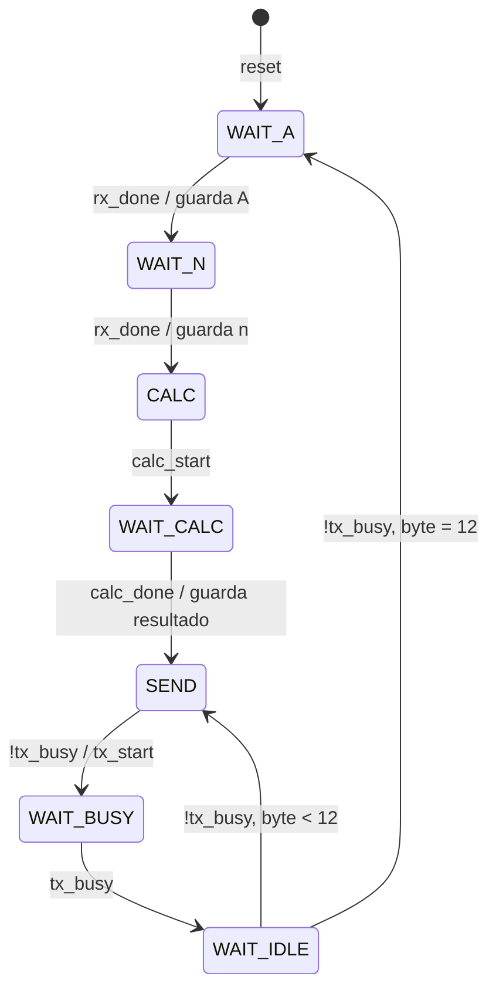

# 02 · Diseño en la FPGA

[← Volver al README](../README.md)

## Módulos

| Módulo | Función |
|---|---|
| [`top_uart_de10lite`](../hdl/top_uart_de10lite.v) | Integra los módulos y controla la secuencia: recibir, calcular y enviar. |
| [`uart_rx`](../hdl/uart_rx.v) | Recibe tramas 8N1. |
| [`uart_tx`](../hdl/uart_tx.v) | Transmite tramas 8N1. |
| [`potencia_q8020`](../hdl/potencia_q8020.v) | Calcula $A^{n/2}$ en Q80.20. |


## Receptor UART (`uart_rx`)

**1. Sincronización.** La línea RX es asíncrona respecto al reloj de la FPGA, así que pasa por dos flip-flops antes de usarse. Con el reset, ambos quedan en 1, que es el nivel de reposo:

```verilog
meta <= rx;
sync <= meta;
```

**2. Máquina de estados:** `IDLE → START → DATA → STOP`.

| Estado | Acción |
|---|---|
| `IDLE` | Espera un 0 en la línea. |
| `START` | Cuenta `HALF_BIT` (2604 ciclos) y revisa la línea otra vez. Si sigue en 0, pasa a `DATA`; si no, era un pulso espurio y vuelve a `IDLE`. |
| `DATA` | Cada `CLKS_PER_BIT` (5208 ciclos) guarda `shift[bit_index] <= sync`, empezando por el LSB. |
| `STOP` | Si el bit de paro es 1, entrega `data_out` y activa `data_valid` durante un ciclo. Si no, descarta la trama. |

```verilog
localparam integer CLKS_PER_BIT = CLK_FREQ / BAUD_RATE;  // 5208
localparam integer HALF_BIT     = CLKS_PER_BIT / 2;      // 2604
```

## Transmisor UART (`uart_tx`)

Cuando está libre y recibe `tx_start`, arma la trama en un registro de 10 bits y baja la línea de inmediato para el bit de inicio:

```verilog
frame <= {1'b1, data_in, 1'b0};   // paro | datos | inicio
tx    <= 0;
busy  <= 1;
```

Cada 5208 ciclos desplaza el registro a la derecha y saca el siguiente bit. Por la izquierda entran unos, así que la línea termina en reposo. `busy` se mantiene activo durante los 10 bits.

## Módulo de cálculo (`potencia_q8020`)

Máquina de estados: `IDLE → MULT → FINISH`.

```verilog
IDLE:   remaining <= n[3:1];  odd <= n[0];  power <= 80'd1;   // k y r
MULT:   power <= power * a_reg;   // se repite k veces
FINISH: result_q <= odd ? odd_product[99:0]     // A^k * sqrt(A) en Q20
                        : {power, 20'd0};       // A^k * 2^20
```

```verilog
wire [31:0]  root_q20    = isqrt64({16'd0, a_reg, 40'd0});  // floor(sqrt(A)*2^20)
wire [111:0] odd_product = power * root_q20;
```

- `power` es entero y `root_q20` ya trae 20 bits fraccionarios, así que su producto queda directamente en Q80.20.
- La latencia es de **k + 2 ciclos** desde `start`. El peor caso, con n = 14 o 15, son 9 ciclos (180 ns).
- `done` se activa durante un ciclo cuando `result_q` es válido.

## Máquina de estados principal (`top_uart_de10lite`)



- `SEND` siempre transmite `result_reg[7:0]`. En `WAIT_IDLE`, el registro se desplaza 8 bits (`result_reg >> 8`), así que el envío es **little-endian**.
- `WAIT_BUSY` espera a que el transmisor confirme que empezó. Sin este estado, `WAIT_IDLE` podría leer `tx_busy = 0` antes de que suba y saltarse un byte.

## Entradas, salidas y pines

| Señal | Dirección | Recurso | Pin |
|---|---|---|---|
| `CLOCK_50` | Entrada | Reloj de 50 MHz | `PIN_P11` |
| `RESET_N` | Entrada | KEY[0] (activo en bajo) | `PIN_B8` |
| `UART_RX` | Entrada | GPIO ← GPIO17 del ESP32 | _completar_ |
| `UART_TX` | Salida | GPIO → GPIO16 del ESP32 | _completar_ |

Las asignaciones están en [`quartus/asignacion_pines.tcl`](../quartus/asignacion_pines.tcl).
